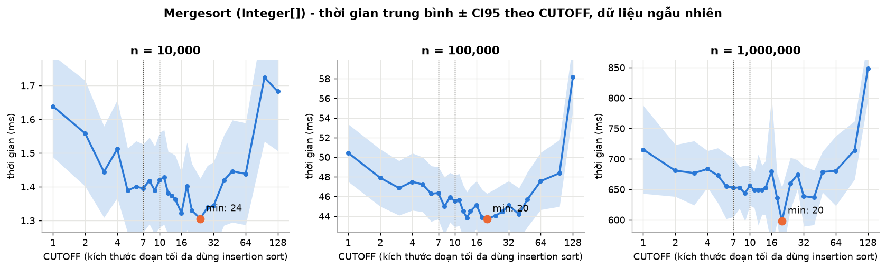
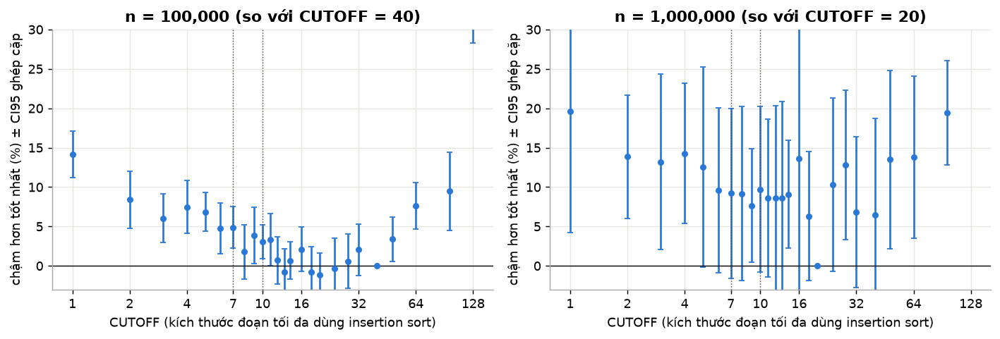

# 1. Mục tiêu

Bài giảng Mergesort đề xuất cải tiến: khi đoạn con a[lo..hi] có kích thước nhỏ thì chuyển sang insertion sort, với `CUTOFF` ≈ 7 (giáo trình cũ) hoặc ≈ 10 (giáo trình mới). Báo cáo này trả lời câu hỏi: **với cài đặt mergesort dựng từ bài giảng và trên máy cá nhân của tôi, giá trị CUTOFF nào cho thời gian chạy tốt nhất, và 7 / 10 kém tối ưu bao nhiêu?**

# 2. Cài đặt

Ngôn ngữ: Java. Mã nguồn trong thư mục `src/`.

* `Merge.java` — mergesort top-down dựng đúng theo slide: `merge(a, aux, lo, mid, hi)` (copy sang `aux` rồi trộn ngược về `a`), và `sort(a, aux, lo, hi)` có điều kiện dừng `if (hi <= lo + CUTOFF - 1) { Insertion.sort(a, lo, hi); return; }`. Mảng `Comparable[]` (thí nghiệm dùng `Integer[]`).
* `Insertion.java` — insertion sort trên đoạn `a[lo..hi]` (dạng hoán đổi từng cặp kề nhau như bài giảng Elementary Sorts; slide bài này không nằm trong tài liệu đính kèm nên dùng dạng chuẩn của Sedgewick–Wayne).
* `CUTOFF` được truyền như tham số của `sort` để một chương trình đo quét được nhiều giá trị. `CUTOFF = 1` tương đương mergesort thuần (đoạn 1 phần tử thì dừng).
* Không dùng các cải tiến khác của bài giảng (bỏ qua merge nếu đã sắp, đổi vai `aux`/`a`) để chỉ đo riêng ảnh hưởng của CUTOFF.
* `MergeInt.java` — biến thể `int[]` cùng cấu trúc, dùng cho thí nghiệm phụ (ảnh hưởng của kiểu dữ liệu).
* `TestMerge.java` — kiểm tra đúng đắn: 1875 trường hợp (mọi CUTOFF × 15 kích thước gồm 0, 1, 2 × 5 bộ dữ liệu, so với `Arrays.sort`) đều đạt.

# 3. Thiết kế thí nghiệm

**Môi trường.** Máy cá nhân (laptop, cắm điện trong suốt thời gian đo): Intel Core i5-13450HX (10 nhân, 16 luồng), RAM 12 GB, Windows 11 Home; Java: OpenJDK Temurin 25.0.4; chạy trong Git Bash bằng `bash scripts/run_all.sh`. JVM chạy với `-Xms3g -Xmx3g -XX:+UseParallelGC` để heap không đổi kích thước giữa chừng.

**Giá trị CUTOFF khảo sát (25 giá trị):** 1–14 (mọi số nguyên), 16, 18, 20, 24, 28, 32, 40, 48, 64, 96, 128 — gồm cả 7 và 10.

**Dữ liệu** (`data/`, sinh bằng `scripts/gen_data.py`, seed cố định nên tái lập được; mỗi file một số nguyên mỗi dòng):

| Loại | Kích thước n | Số file | Mục đích |
|:--|:--|:--|:--|
| Ngẫu nhiên đều (`random`) | 10 000; 100 000; 1 000 000 | 5 file (5 seed) mỗi n | Thí nghiệm chính |
| 10 giá trị khác nhau (`fewdistinct`) | 100 000; 1 000 000 | 1 | Độ nhạy theo dữ liệu |
| Gần như đã sắp (`nearlysorted`, 1% cặp bị hoán vị) | 100 000; 1 000 000 | 1 | Độ nhạy theo dữ liệu |
| Giảm dần (`reversed`) | 100 000; 1 000 000 | 1 | Độ nhạy theo dữ liệu |

**Quy trình đo** (`src/Bench.java`):

1. Khởi động JIT: chạy trước vài vòng đủ mọi CUTOFF trên dữ liệu cùng loại, không ghi nhận; gọi `System.gc()` rồi mới đo.
2. Mỗi "vòng": mỗi CUTOFF chạy đúng một lần trên cùng một file dữ liệu; **thứ tự các CUTOFF được xáo ngẫu nhiên mỗi vòng** để trôi nhiễu của máy/JIT/GC không dồn vào một CUTOFF nào.
3. Số vòng: 100 (n = 10⁴), 50 (n = 10⁵), 30 (n = 10⁶) cho dữ liệu ngẫu nhiên, vòng lặp luân phiên qua 5 file; 30 / 10 vòng cho các loại dữ liệu phụ.
4. Mỗi lần chạy: sao chép mảng gốc (không tính giờ) → đo bằng `System.nanoTime()` toàn bộ `Merge.sort(a, cutoff)` (kể cả cấp phát `aux`) → kiểm tra đã sắp xếp (ngoài đoạn tính giờ).
5. Hai chế độ: `boxed` (`Integer[]`, đúng theo bài giảng, so sánh qua `compareTo`) là thí nghiệm chính; `prim` (`int[]`) là thí nghiệm phụ. Tổng cộng 12 000 lần đo trong `results/raw_*.csv`.

**Thống kê** (`scripts/analyze.py`): với mỗi (kiểu, n, CUTOFF) tính trung bình, độ lệch chuẩn, khoảng tin cậy 95% (phân phối t), trung vị. Vì trong một vòng mọi CUTOFF chạy trên cùng một dữ liệu nên so sánh với CUTOFF tốt nhất (trung vị nhỏ nhất) dùng **hiệu ghép cặp** theo (file, vòng), kèm CI95 của hiệu và kiểm định Wilcoxon. Một CUTOFF được coi là "không phân biệt được với tốt nhất" khi CI95 của hiệu ghép cặp chứa 0 (chưa hiệu chỉnh so sánh bội, nên tiêu chí này khá thoáng). Để gộp qua các n, dùng trung bình hình học của "trung vị / trung vị nhỏ nhất" (`results/pooled_random.csv`).

# 4. Kết quả

## 4.1. Dữ liệu ngẫu nhiên, `Integer[]` (thí nghiệm chính)

{width=100%}

| n | CUTOFF tốt nhất (trung vị) | Tốt nhất (trung bình) | Vùng không phân biệt được với tốt nhất | CUTOFF=1 chậm hơn | CUTOFF=7 chậm hơn | CUTOFF=10 chậm hơn |
|--:|--:|--:|:--|--:|--:|--:|
| 10 000 | 20 | 24 | 5–40 | +25.5% | +6.9% | +8.9% |
| 100 000 | 40 | 20 | 8–40 | +15.5% | +6.1% | +4.2% |
| 1 000 000 | 20 | 20 | 5–40 | +19.6% | +9.2% | +9.7% |

(Phần trăm "chậm hơn" tính theo thời gian trung bình so với CUTOFF có trung bình nhỏ nhất.) Bảng đầy đủ cho mọi CUTOFF nằm trong `results/tables.md`; ví dụ n = 10⁶:

| CUTOFF | Trung bình (ms) | ± CI95 | Trung vị (ms) | Độ lệch chuẩn | So với tốt nhất |
|--:|--:|--:|--:|--:|--:|
| 1 | 715.3 | 72.2 | 731.0 | 193.4 | +19.6% |
| 4 | 683.3 | 30.0 | 696.0 | 80.4 | +14.3% |
| 7 | 652.9 | 48.2 | 675.3 | 129.1 | +9.2% |
| 10 | 656.0 | 32.5 | 657.2 | 87.1 | +9.7% |
| 16 | 679.4 | 122.7 | 658.5 | 328.6 | +13.6% |
| **20** | **597.9** | 55.6 | 645.8 | 148.8 | tốt nhất |
| 32 | 638.8 | 49.4 | 667.3 | 132.3 | +6.8% |
| 40 | 636.5 | 44.8 | 663.8 | 120.0 | +6.5% |
| 64 | 680.3 | 57.2 | 722.3 | 153.2 | +13.8% |
| 128 | 848.0 | 49.9 | 863.2 | 133.7 | +41.8% |

{width=100%}

**Về độ nhiễu.** Số đo trên máy này nhiễu đáng kể: hệ số biến thiên (độ lệch chuẩn / trung bình) của `Integer[]` với dữ liệu ngẫu nhiên khoảng 45–55% ở n = 10⁴, 19–25% ở n = 10⁵ và 10–48% ở n = 10⁶. Ở n = 10⁶, trung vị thời gian của từng vòng dao động từ khoảng 270 ms đến 760 ms giữa các vòng, nghĩa là cả tốc độ chung của máy thay đổi theo thời gian (nguyên nhân chưa kiểm chứng; có thể do lập lịch của hệ điều hành trên CPU lai nhiều loại nhân, chế độ năng lượng hoặc tiến trình nền). Vì vậy so sánh theo trung vị và theo hiệu ghép cặp đáng tin hơn so với so sánh từng giá trị trung bình riêng lẻ — chẳng hạn ở n = 10⁶ giá trị trung bình thấp nhất (CUTOFF = 20) thấp hơn các lân cận nhiều hơn so với chênh lệch của trung vị (645.8 ms so với 651.9 ms ở CUTOFF = 18 và 658.5 ms ở 16).

**Nhận xét.**

* Đường cong có dạng chữ U (Hình 1): giảm từ CUTOFF = 1 đến khoảng 12–20, **vùng phẳng rộng khoảng 12–40**, rồi tăng mạnh khi CUTOFF lớn (insertion sort O(k²) trên đoạn dài thắng thế; ở 128 chậm hơn tốt nhất ≈ 30–42%).
* So với mergesort thuần (CUTOFF = 1), CUTOFF = 7 hoặc 10 đã nhanh hơn khoảng 8–15%, và vùng tối ưu nhanh hơn khoảng 13–20%.
* So 7 / 10 với CUTOFF tốt nhất: về trung bình chậm hơn khoảng 4–10%, nhưng mức ý nghĩa thống kê **không đồng đều giữa các n**. Ở n = 10⁵ cả 7 và 10 đều chậm hơn có ý nghĩa (CI95 ghép cặp của hiệu không chứa 0, Hình 2, trái). Ở n = 10⁴ và 10⁶, CI95 của hiệu trung bình chứa 0 vì nhiễu lớn (kiểm định Wilcoxon cho p nhỏ với CUTOFF = 7 ở cả ba n, p ≈ 10⁻⁴–10⁻³, còn với CUTOFF = 10 ở n = 10⁶ là p ≈ 0.10). Hướng chênh lệch nhất quán, nhưng độ lớn chưa xác định chính xác.
* Điểm cực tiểu thay đổi theo n và theo cách tính (20/24, 40/20, 20/20 cho trung vị/trung bình): các giá trị trong vùng 12–40 chênh nhau ít hơn nhiễu đo, nên "tốt nhất" thực chất là một **vùng**, không phải một giá trị duy nhất.

Chỉ số gộp qua 3 kích thước (`results/pooled_random.csv`; 1.000 = tốt nhất; càng thấp càng tốt):

| CUTOFF | 1 | 4 | 7 | 10 | 12 | 16 | **20** | 24 | 32 | 40 | 48 | 64 | 128 |
|:--|--:|--:|--:|--:|--:|--:|--:|--:|--:|--:|--:|--:|--:|
| `Integer[]` | 1.160 | 1.096 | 1.058 | 1.035 | 1.020 | 1.016 | **1.000** | 1.016 | 1.024 | 1.031 | 1.047 | 1.084 | 1.296 |
| `int[]` | 1.303 | 1.170 | 1.114 | 1.083 | 1.081 | 1.041 | 1.064 | 1.035 | 1.034 | 1.039 | 1.068 | 1.078 | 1.243 |

Theo chỉ số này, với `Integer[]` CUTOFF = 20 là nhỏ nhất, mọi giá trị từ 12 đến 40 nằm trong khoảng 3.1% của nó, CUTOFF = 7 chậm hơn 5.8% và CUTOFF = 10 chậm hơn 3.5%.

## 4.2. Kiểu dữ liệu `int[]` và các loại dữ liệu khác

![Hình 3. Thời gian tương đối (1.0 = tốt nhất) theo CUTOFF, dữ liệu ngẫu nhiên, hai kiểu mảng. Đường của `int[]` lởm chởm hơn do nhiễu.](../results/fig2_relative_boxed_vs_prim.png){width=100%}

Với `int[]` cùng hình dạng chữ U nhưng nhiễu hơn: cực tiểu theo trung vị lần lượt là 24 (n = 10⁴), 28 (10⁵), 64 (10⁶), và ở n = 10⁶ các giá trị 16–96 không phân biệt được với nhau trong phép so sánh ghép cặp. Chỉ số gộp có cực tiểu ở 28 (1.017), và các giá trị 24–40 đều dưới 1.04; CUTOFF = 7 là 1.114 và CUTOFF = 10 là 1.083, nghĩa là với `int[]` 7 và 10 kém tối ưu rõ hơn so với `Integer[]`. Dữ liệu này không đủ để khẳng định chắc vùng tối ưu của `int[]` khác `Integer[]`.

![Hình 4. Độ nhạy theo loại dữ liệu (`Integer[]`).](../results/fig4_data_types.png){width=100%}

| Loại dữ liệu (`Integer[]`) | n | CUTOFF tốt nhất (trung vị) | Vùng không phân biệt được |
|:--|--:|--:|:--|
| 10 giá trị khác nhau | 10⁵ / 10⁶ | 32 / 18 | 6–48 / 13–28 |
| Gần như đã sắp | 10⁵ / 10⁶ | 11 / 128 (biên) | 6–128 / 128 |
| Giảm dần | 10⁵ / 10⁶ | 6 / 13 | 6–11 / 5–14 |

* Dữ liệu **nhiều khoá trùng**: tương tự dữ liệu ngẫu nhiên.
* Dữ liệu **gần như đã sắp**: insertion sort gần tuyến tính nên CUTOFF lớn có lợi; ở n = 10⁶ cực tiểu nằm ở biên khảo sát (128) và đường 10⁵ rất lởm chởm (cực tiểu theo trung vị là 11 nhưng theo trung bình là 128), nên kết quả cho loại dữ liệu này kém chắc chắn; muốn kết luận cần khảo sát thêm CUTOFF lớn hơn 128.
* Dữ liệu **giảm dần** (trường hợp xấu nhất của insertion sort): vùng tối ưu thấp, khoảng 5–14; CUTOFF lớn làm thời gian tăng mạnh (ở 128 gấp khoảng 2.6 lần tốt nhất, Hình 4).

# 5. Kết luận

1. Trên máy này, với cài đặt mergesort dựng từ bài giảng (`Integer[]`, dữ liệu ngẫu nhiên), **CUTOFF tối ưu nằm trong vùng khoảng 12–40**. Ước lượng điểm là **CUTOFF ≈ 20** (cực tiểu của chỉ số gộp qua ba kích thước; đồng thời là cực tiểu theo trung bình ở n = 10⁵ và 10⁶, và theo trung vị ở n = 10⁶).
2. CUTOFF = 7 và 10 của giáo trình chậm hơn vùng tối ưu khoảng 3.5–6% theo chỉ số gộp (4–10% theo trung bình từng n); chênh lệch này chỉ có ý nghĩa thống kê vững ở n = 10⁵, còn ở n = 10⁴ và 10⁶ bị nhiễu đo che bớt. Cả hai vẫn nhanh hơn mergesort thuần khoảng 8–15%.
3. Đường cong phẳng quanh tối ưu: không nên diễn giải một giá trị duy nhất (như 20 hay 40) quá chặt; chọn trong 12–40 chỉ khác nhau vài phần trăm. Cải tiến CUTOFF đem lại khoảng 13–20% thời gian so với mergesort thuần.
4. Giá trị tốt nhất phụ thuộc kiểu dữ liệu và phân phối đầu vào: dữ liệu giảm dần thích CUTOFF nhỏ (≈ 5–14), dữ liệu gần như đã sắp thích CUTOFF lớn; `int[]` cho vùng tối ưu hơi lệch lên (≈ 24–40) nhưng nhiễu hơn.

# 6. Hạn chế

* Số đo trên laptop nhiễu (hệ số biến thiên tới 20–55% ở nhiều cấu hình; tốc độ chung của máy đổi tới ~2.8 lần giữa các vòng ở n = 10⁶). Để tăng độ chính xác nên tăng số vòng đo, tắt ứng dụng nền, đặt chế độ nguồn hiệu năng cao và cố định luồng vào một nhân hiệu năng; chưa làm các bước đó.
* Một JVM chạy mọi CUTOFF với tham số truyền lúc chạy (không phải hằng `static final`); JIT không "gập" hằng CUTOFF. Dùng hằng số có thể làm thay đổi nhẹ các con số.
* Tiêu chí "không phân biệt được" chưa hiệu chỉnh so sánh bội (25 CUTOFF so với tốt nhất). Vùng 12–40 nên hiểu là vùng "gần tối ưu", không phải khoảng tin cậy chính thức cho CUTOFF tối ưu.
* Chỉ khảo sát n tối đa 10⁶ và một cấu hình phần cứng; chỉ đo thời gian (chưa đếm số phép so sánh/hoán đổi).
* Cùng một mảng đối tượng `Integer` được dùng lại qua các lần chạy (vị trí bộ nhớ không đổi), nên kết quả `boxed` phản ánh bố trí bộ nhớ đó.

# 7. Cấu trúc sản phẩm nộp

```
src/       Merge.java, Insertion.java, MergeInt.java, Bench.java, TestMerge.java
scripts/   gen_data.py, run_all.sh, analyze.py
data/      bộ dữ liệu thí nghiệm (21 file .txt)
results/   raw_*.csv (số liệu đo thô), summary_all.csv, paired_vs_best.csv,
           conclusions.csv, pooled_random.csv, tables.md, fig*.png
docs/      report.docx, chat_log.md
```

Cách chạy lại: `bash scripts/run_all.sh`, sau đó `python scripts/analyze.py`.
